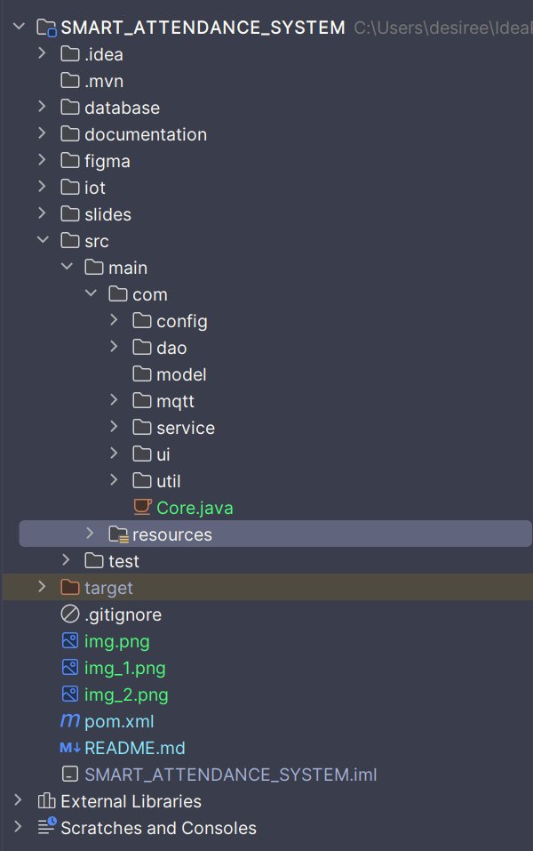

# PROJECT OVERVIEW

This is the project overview for the project title "Development of A Smart Attendance System Java Desktop Application with IoT Integration for Dasmarinas East Integrated High School".

## DEPENDENCIES

Below are the dependencies needed to install on your IDE in order for the pom.xml to run properly:

* MySQL ConnectorJ --v26.10.0 (JDBC driver)
* HiveMQTT --v1.4.2 (MQTT subscriber for NodeMCU)
* FlatLaF --v3.5.4 (Alternative to CSS styling on JavaFX)
* JBCrypt --v0.4 (Password hashing)
* slf4j-simple --v2.0.16 (Logging)
* Maven Surefire Plugin --v3.5.2 (Unit testing)
* OpenCsv --v5.12.0 (For CSV exports)
* Apache POI --v6.0.0 (For xlsx exports)
* HikariCP --v5.0.1 (Connection pooling)
* OpenPDF --v2.0.3 (PDF report generation)
* MySQL --v8.any (Database)
## MAVEN STRUCTURE

This project will use a maven build w/ regular archetype & will have the following project structure/tree given below:

* Database - Contains the actual database information, tables like user, teacher, admin... and will serve as a schema backup in the case that the JDBC is unable to connect to localhost or URL.
* Documentation - Will serve as the PDF and DOCS for the project.
* Figma - The initial design sketch for the main dashboard of the application.
* IoT - Contains the pinouts and schemaic diagram for the RFID reader.
* Slides - Powerpoint slides, initial and final for oral presentation
* Src - Main source code.

## FRONT END DEVELOPMENT

Using the file format tree below under the file path src/main/com/ui, the dashboards and panels will be separated by the following roles:

* Admin
* Teacher
* Student

### Figma Sketch

The dashboard will have two modes: light and dark. Below is a rough sketch of what the dashboards will hope to look like showing an overview of the functions of the application:

## BACK END DEVELOPMENT

W.I.P

## HARDWARE DEVELOPMENT

W.I.P

## INTEGRATION