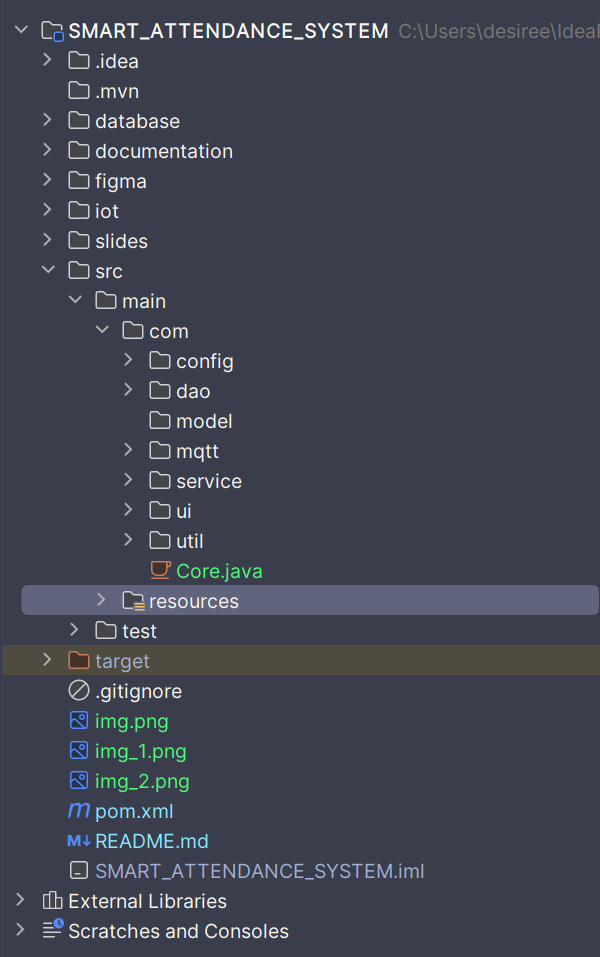
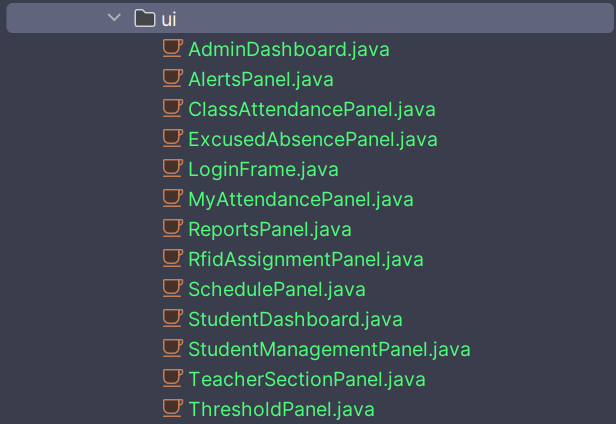
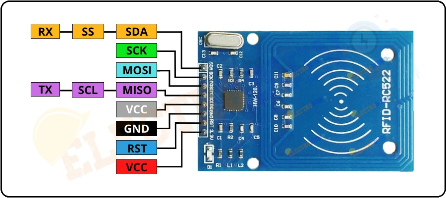
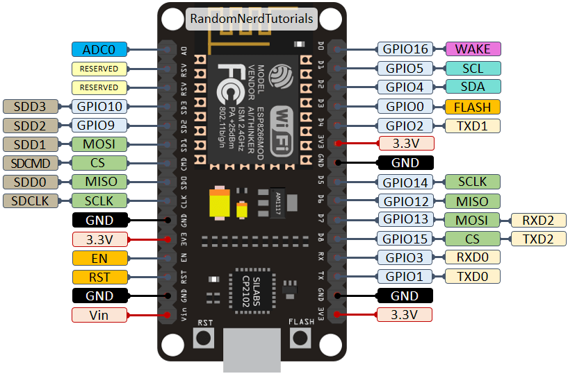
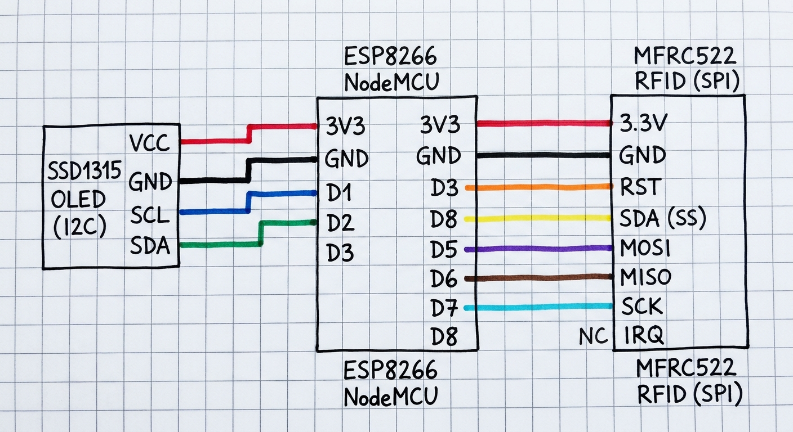
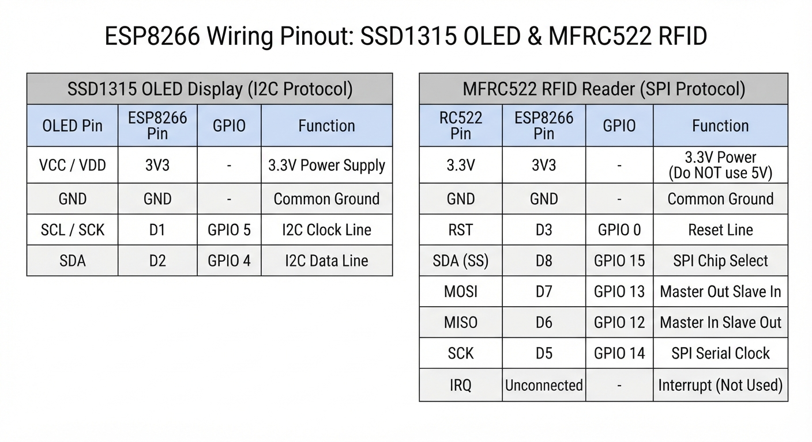

# Smart Attendance System

**Development of a Smart Attendance System Java Desktop Application with IoT Integration for Dasmarinas East Integrated High School (DEIHS)**

An IoT-enabled attendance system that replaces manual paper logs. Students tap an RFID card on an RC522 reader, a NodeMCU ESP8266 publishes the card UID over MQTT, and a Java Swing desktop application validates the scan, records the attendance in MySQL, and updates role-based dashboards in real time.

> Grade 11 TVL-ICT, Computer Programming (Java), TechPro C | Group **JAVAFIGHTERS** | Adviser: Ryan John D. Delos Santos | December 2026

---

## Table of Contents

1. [Features](#features)
2. [How It Works](#how-it-works)
3. [Tech Stack and Dependencies](#tech-stack-and-dependencies)
4. [Project Structure](#project-structure)
5. [Getting Started](#getting-started)
6. [Front-End Development](#front-end-development)
7. [Back-End Development](#back-end-development)
8. [Hardware Development](#hardware-development)
9. [Integration](#integration)
10. [Project Status](#project-status)
11. [Known Issues and Notes](#known-issues-and-notes)
12. [Documentation](#documentation)
13. [Team](#team)

---

## Features

1. **Real-time RFID logging:** instant tap-in and tap-out linked to each student's ID.
2. **Automated attendance and absence tracking:** running counts of present, late, absent, and excused days.
3. **Schedule verification and out-of-bounds alerts:** flags scans that do not match the section's class schedule.
4. **Threshold notifications:** highlights students approaching or exceeding the allowed number of absences.
5. **Role-based dashboards and reports:** Admin, Teacher, and Student views, with daily/weekly summaries and CSV, Excel, and PDF export.
6. **Secure login:** BCrypt-hashed passwords with role-based access.

## How It Works

```
RC522 reader --> NodeMCU ESP8266 --> MQTT broker --> Java Swing app --> MySQL
 (tap card)      (reads UID,          (message        (validates scan,   (stores records,
                  shows status        transport)       updates GUI)       alerts, settings)
                  on OLED)
```

1. A student taps their card on the **RC522** reader.
2. The **ESP8266** reads the card UID and publishes it to the **MQTT broker**.
3. The Java app (an MQTT subscriber) receives the UID and runs these checks:
   - Is the card registered? If not, log an invalid-card attempt and alert the admin.
   - Is the scan within the section's class schedule? If not, flag it as out-of-bounds and alert the admin.
   - Otherwise, record the time-in or time-out and update the attendance counts.
   - Has the student reached the absence threshold? If so, highlight the student and notify the admin.
4. The result is shown on the **SSD1315 OLED** and the GUI dashboard refreshes.

The full process is in `documentation/Flowchart.pdf`.

## Tech Stack and Dependencies

| Layer | Technology |
|---|---|
| Language | Java 21 (Swing GUI) |
| Build tool | Maven |
| IDE | IntelliJ IDEA, Visual Studio Code |
| Database | MySQL 8.x |
| IoT hardware | NodeMCU ESP8266, RC522 RFID module, SSD1315 OLED (128x64) |
| Messaging | MQTT (an MQTT broker such as Eclipse Mosquitto must be running) |

Dependencies are declared in `pom.xml`:

| Dependency | Version | Purpose |
|---|---|---|
| MySQL Connector/J | 26.10.0 | JDBC driver |
| HiveMQ MQTT Client | 1.4.2 | MQTT subscriber for the NodeMCU messages |
| FlatLaf | 3.5.4 | Modern look-and-feel for Swing (light and dark themes) |
| jBCrypt | 0.4 | Password hashing |
| HikariCP | 5.1.0 | JDBC connection pooling |
| OpenCSV | 5.12.0 | CSV export |
| Apache POI (`poi-ooxml`) | 6.0.0 | Excel (.xlsx) export |
| OpenPDF | 2.0.3 | PDF report generation |
| slf4j-simple | 2.0.16 | Logging |
| JUnit Jupiter | 5.11.3 (test) | Unit tests |
| Maven Surefire Plugin | 3.5.2 | Runs the unit tests |

`commons-lang3` (3.20.0), `commons-codec` (1.23.0), and `log4j-api` (2.25.5) are pinned in `<dependencyManagement>` to force patched versions of libraries that POI and OpenCSV pull in.

## Project Structure

This is a Maven project with the following folders:

| Folder | Contents |
|---|---|
| `database/` | `schema.sql`: the full database schema and sample data. Also serves as a backup if the JDBC connection to the database fails. |
| `documentation/` | Project PDFs: title page, flowchart, Gantt chart, system documentation format, oral defense guide. |
| `figma/` | The design sketches of the dashboards and panels (light and dark modes). |
| `iot/` | Pinouts and schematic references for the RFID reader and NodeMCU. |
| `slides/` | PowerPoint slides for the oral presentation. |
| `src/` | The main source code. |



Source packages:

| Package | Responsibility |
|---|---|
| `config` | `AppConfig` loads `db.properties` and builds the JDBC URL |
| `model` | Plain data classes (Student, Teacher, AttendanceRecord, and so on) |
| `dao` | All SQL access: `JDBC`, `UserDao`, `StudentDao`, `TeacherDao`, `SectionDao`, `ScheduleDao`, `AttendanceDao`, `AlertDao` |
| `service` | Business logic: `AuthService`, `StudentService`, `ScheduleService`, `AttendanceService`, `ReportService` |
| `mqtt` | `MqttConfig`, `MqttListener`, `ScanListener` |
| `ui` | Swing dashboards and panels |
| `util` | `PasswordUtil`, `DateTimeUtil`, `ValidationUtil`, `SessionManager` |

## Getting Started

### Prerequisites

- JDK 21 (or change `maven.compiler.source` and `target` in `pom.xml` to match your JDK)
- Maven (bundled with IntelliJ IDEA)
- MySQL 8.x running locally or on your network
- An MQTT broker (for example, Eclipse Mosquitto)

### 1. Create the database

Run `database/schema.sql` in MySQL Workbench (File > Open SQL Script, then Execute).

> **Warning:** the script begins with `DROP DATABASE IF EXISTS smart_attendance;`, so it erases any existing data in that database.

The sample accounts in the script use **placeholder password hashes**. Generate real hashes with `BCrypt.hashpw("yourPassword", BCrypt.gensalt())` and replace them, or the login will reject those accounts.

### 2. Configure the connection

Edit `src/main/resources/db.properties`:

```properties
db.host=127.0.0.1
db.port=3307
db.name=smart_attendance
db.user=root
db.password=your_password_here
db.pool.size=10
```

Any value can be overridden at launch with a JVM flag, for example `-Ddb.port=3306`. The JDBC URL uses the `Asia/Manila` time zone.

### 3. Load the Maven project

Open the project in IntelliJ IDEA and click **Reload All Maven Projects**.

### 4. Run

The application's entry point is still being built. Once it is in place, run it from IntelliJ with the main class.

## Front-End Development

The dashboards and panels live in `src/main/com/ui` and are separated by role:

- Admin
- Teacher
- Student



### Components

Each role sees different screens and features.

#### Administrator

| Screen | Functions |
|---|---|
| Overview | Live statistics on enrolled, present, absent, and excused students; current RFID activity; quick actions to register a card and generate a report |
| Students | Student directory with add, edit, delete, search, and filtering |
| Teachers & sections | Manage teachers, sections, and advisers |
| Class schedules | Manage the schedules used to verify scans |
| RFID cards | Register cards and assign them to students |
| Alerts & thresholds | Review invalid-card attempts, out-of-bounds scans, and students near or over the absence limit |
| Reports | Generate and export attendance reports |

#### Teacher

| Screen | Functions |
|---|---|
| Overview | Class strength and today's present, absent, and excused counts |
| Class attendance | View the class attendance list with search and export |
| Excused absences | Mark absences as excused with a reason |
| Threshold watch | Students approaching the absence limit |
| Reports | Daily and weekly summaries |

#### Student

| Screen | Functions |
|---|---|
| Overview | Attendance rate, present days, absent days, excused days, and today's status |
| My attendance | Own attendance record and calendar |
| Excused days | View excused days and their reasons |

### Figma Sketch

The dashboard has two modes, light and dark. Below is the sketch of the main dashboards for each role:


Additional panels (student directory, RFID card management, class attendance, threshold watch, attendance history, excused days) and the color palette are in `figma/Other Panels & Palette.png`.

## Back-End Development

The project uses a MySQL database (`smart_attendance`) that can be hosted locally or on a network. All tables are created by `database/schema.sql`.

### Tables

| Table | Purpose | Key columns |
|---|---|---|
| `users` | Login accounts | `user_id`, `username`, `password_hash`, `role` (ADMIN / TEACHER / STUDENT), `is_active`, `last_login` |
| `teachers` | Teacher profiles | `teacher_id`, `user_id`, `employee_no`, `full_name`, `email`, `contact_no` |
| `sections` | Class sections | `section_id`, `section_name`, `grade_level`, `strand`, `school_year`, `adviser_id` |
| `students` | Student profiles | `student_id`, `user_id`, `lrn`, `full_name`, `grade_level`, `section_id`, `status` |
| `rfid_cards` | Card-to-student assignments | `card_id`, `card_uid`, `student_id`, `status` (ACTIVE / LOST / DISABLED) |
| `class_schedules` | Schedules for the "within class time?" check | `schedule_id`, `section_id`, `teacher_id`, `subject`, `day_of_week`, `start_time`, `end_time`, `room` |
| `attendance_records` | One row per student per day | `record_id`, `student_id`, `attendance_date`, `time_in`, `time_out`, `status` (PRESENT / LATE / ABSENT / EXCUSED) |
| `scan_logs` | Audit trail of every tap | `log_id`, `card_uid`, `student_id`, `scan_time`, `result` (TIME_IN / TIME_OUT / INVALID_CARD / OUT_OF_BOUNDS) |
| `excused_absences` | Teacher-marked excused days | `excused_id`, `student_id`, `absence_date`, `reason`, `marked_by` |
| `alerts` | Admin alerts | `alert_id`, `alert_type`, `student_id`, `card_uid`, `message`, `is_read` |
| `settings` | Key-value configuration | `setting_key`, `setting_value`, `description` |

There is also a view, `v_student_attendance_summary`, which gives present, late, absent, and excused day counts per student. It feeds the threshold list and dashboards.

### Relationships

- A `user` has at most one `teacher` or `student` profile.
- A `section` has many `students` and many `class_schedules`, and one adviser (a `teacher`).
- A `student` has `rfid_cards`, `attendance_records`, `scan_logs`, `excused_absences`, and `alerts`.
- `attendance_records` and `excused_absences` are unique per student per day.

### Settings

| Key | Default | Meaning |
|---|---|---|
| `absence_threshold` | 10 | Maximum allowed absences before the drop/expulsion flag |
| `absence_warning_offset` | 2 | Warn when a student is this many absences from the threshold |
| `late_grace_minutes` | 15 | Minutes after the start time before a student is marked LATE |

The default threshold is a sample value. Set it to the limit in the school's policy.

## Hardware Development

Components used:

| Component | Role |
|---|---|
| NodeMCU ESP8266 | Wi-Fi microcontroller; reads the card and publishes the UID over MQTT |
| RC522 RFID module with tags | Reads the student cards |
| SSD1315 OLED 128x64 | Shows the scan status to the student |

 ### Pinouts Reference
Below are the reference pictures of the pinouts of each components: 



### Schematic Diagram

A rough `schematic diagram` & `wiring` are shown below to be used as a reference for the final implementation:


## Integration

Full system integration connects three parts: the ESP8266 firmware publishing UIDs, the MQTT broker, and the Java application subscribing and writing to MySQL. In the Java application:

- `MqttListener` receives each UID and passes it to `AttendanceService`.
- `AttendanceService` applies the registered-card, class-schedule, and threshold checks, then writes to the database through the DAOs.
- Because MQTT callbacks arrive on a background thread, GUI updates must go through `SwingUtilities.invokeLater(...)`.

Integration is in progress.

## Project Status

| Area | Status |
|---|---|
| Documentation, flowchart, Gantt chart | Done |
| Figma dashboard sketches | Done |
| Database schema (`schema.sql`) | Done |
| Maven setup and dependencies | Done |
| `AppConfig` (database configuration) | Done |
| DAO, service, model, MQTT, UI, and util classes | Files created, implementation pending |
| ESP8266 firmware and RFID wiring | In progress |
| Reports and exports | Not started |
| Testing and integration | Not started |

## Documentation

All project documents are in the `documentation/` folder:

- `TITLE.pdf`: approved title proposal and IoT scope letter
- `Flowchart.pdf`: system flowchart
- `GANTTCHART.pdf`: project timeline (Nov 15 to Dec 15, 2026)
- `PROJECT SYSTEM Documentation.pdf`: Chapters 1 to 5 format and submission checklist
- `ORAL PRESENTATION FINAL DEFENSE.pdf`: defense guide

## Team

**JAVAFIGHTERS** ("Using Java to Fight New Problems"), TechPro C, Grade 11 TVL-ICT

- Bawar, Prince Jarred
- Infante, Jhan-Ry Peligro
- Lat, Daniel Raiven Aquino
- Lipayon, Christopher Tucsano
- Orense, Citrine Delos Santos

Submitted to: **Ryan John D. Delos Santos**, Senior High School Department, Dasmarinas East Integrated High School.
